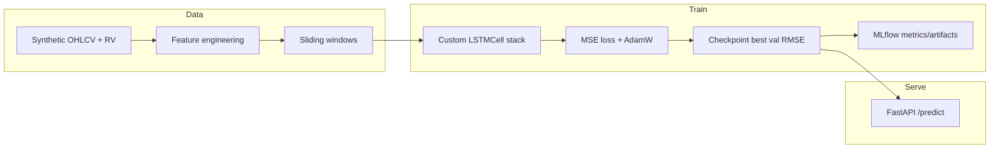
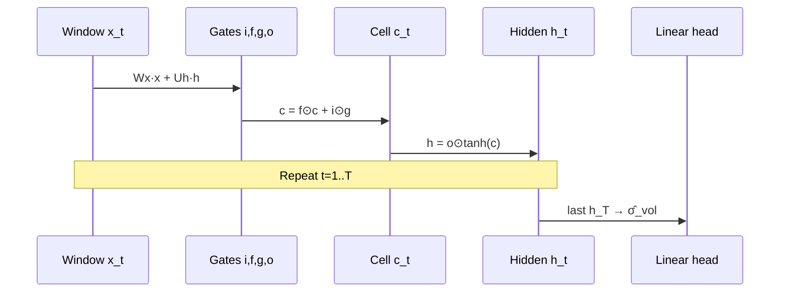

# Financial Time Series Forecaster

**Author:** Douae El Assal · **License:** MIT

Production-shaped portfolio project: a **custom PyTorch LSTM** (explicit gates via `LSTMCell`) that forecasts next-day realized volatility from synthetic OHLCV features, with **MLflow** experiment tracking and a **FastAPI** `/predict` service.

## Stack

| Layer | Choice |
|-------|--------|
| Language | Python 3.11+ |
| Model | Custom `LSTMCell` → stacked `VolatilityLSTM` |
| Tracking | MLflow (`sqlite:///mlflow.db`) |
| Serving | FastAPI + Uvicorn |
| Ops | Docker, docker-compose, GitHub Actions |

## Architecture



### Forward / train complexity

Per timestep, one layer with input dim \(D\) and hidden \(H\):

- Four gate projections (fused): \(\mathcal{O}\bigl(4H(D+H)\bigr)\)
- Elementwise gate / cell updates: \(\mathcal{O}(H)\)

For batch \(B\), length \(T\), \(L\) layers:

\[
\text{Forward} \approx \mathcal{O}\bigl(B \cdot T \cdot L \cdot H \cdot (D+H)\bigr)
\]

BPTT backward pass is the same asymptotic order (roughly \(2\)–\(3\times\) wall-clock from activation storage and duals along the \(T\)-step chain). Dropout between layers does not change the leading term.



## Features

- Stochastic-volatility GBM-style **OHLCV** generator + Parkinson / range features
- Chronological train / val / test split (no leakage)
- **RMSE / MAE / MAPE** on de-normalized volatility
- MLflow params, per-epoch metrics, artifact logging
- FastAPI `GET /health` (public), `POST /predict` (API key when `FTS_API_KEY` is set)
- CPU-only pytest: shapes, smoke train, API auth, e2e train→MLflow→predict

## Quickstart

```bash
python -m venv .venv && source .venv/bin/activate
pip install -e ".[dev]"

# Smoke train (CPU)
python -m fts_forecaster.train --smoke --no-mlflow

# Full train with local MLflow
python -m fts_forecaster.train

# Evaluate checkpoint
python -m fts_forecaster.evaluate --model artifacts/best_model.pt

# API (set FTS_API_KEY for auth; see .env.example)
cp .env.example .env   # edit FTS_API_KEY
uvicorn fts_forecaster.api:app --host 0.0.0.0 --port 8000
```

### Predict example

When `FTS_API_KEY` is set, send `X-API-Key` or `Authorization: Bearer <key>`. `/health` stays public.

```bash
export FTS_API_KEY=change-me-to-a-long-random-secret
curl -s http://localhost:8000/predict \
  -H "Content-Type: application/json" \
  -H "X-API-Key: $FTS_API_KEY" \
  -d '{"sequence": '"$(python -c 'import json; print(json.dumps([[0.0]*5]*30))')"', "already_normalized": true}'
```

## Docker

```bash
cp .env.example .env   # set FTS_API_KEY
python -m fts_forecaster.train --smoke   # produce artifacts/best_model.pt
docker compose up --build api
# Optional MLflow UI:
docker compose --profile mlflow up mlflow
```

## Tests & CI

```bash
pytest -q
python -m fts_forecaster.train --smoke --no-mlflow
```

GitHub Actions runs pytest + a light CPU smoke train on every push/PR.

## Project layout

```
src/fts_forecaster/
  model.py      # LSTMCell with explicit gates + VolatilityLSTM
  data.py       # Synthetic OHLCV + windowing
  train.py      # Training loop + MLflow
  evaluate.py   # Checkpoint eval
  metrics.py    # RMSE / MAE / MAPE
  api.py        # FastAPI service
  config.py     # pydantic-settings
tests/
Dockerfile
docker-compose.yml
.github/workflows/ci.yml
```

## License

MIT © Douae El Assal
